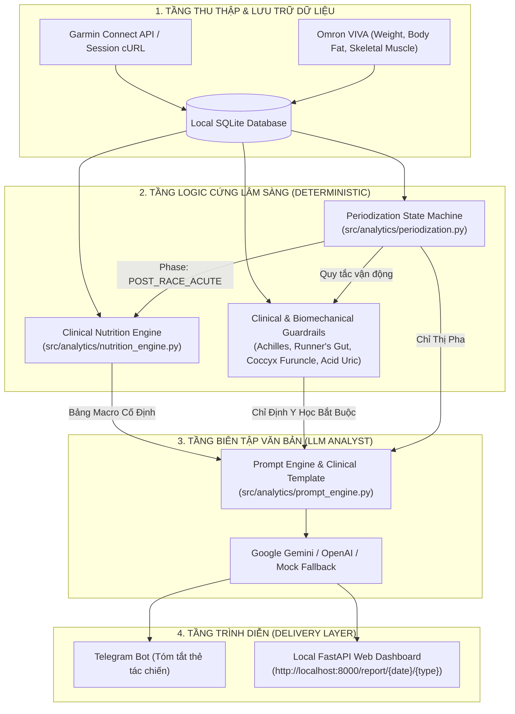

# 🏛️ Garmin Health AI Pipeline - Multi-Tier Clinical Architecture & Data Flow

Tài liệu thiết kế kiến trúc tổng thể và luồng xử lý dữ liệu cho hệ thống **Garmin Health AI Pipeline**, tuân thủ nguyên tắc **Deterministic Core** kết hợp **LLM Editorial Layer**.

---

## 1. Sơ Đồ Kiến Trúc Đa Tầng (4-Layer Clinical Architecture)

---

## 2. Chi Tiết Các Tầng Vận Hành

### Tầng 1: Thu Thập & Lưu Trữ Dữ Liệu (Data Ingestion & Storage)
- **Garmin Connect API:** Thu thập chỉ số sinh lý (HRV Overnight, RHR, Sleep Architecture, Stress, Body Battery, Active Calories, Steps, VO2 max) và động học chạy bộ HRM-Pro (Cadence, GCT Balance L/R, Stride Length).
- **Omron VIVA:** Thu thập thông số thể trạng (Cân nặng thực tế, % Mỡ, % Cơ xương, Mỡ nội tạng).
- **Local SQLite DB:** Lưu trữ dữ liệu chuẩn hóa dạng bảng (`daily_metrics`, `nutrition_logs`, `daily_reports`, `blood_tests`).

### Tầng 2: Logic Cứng Lâm Sàng (Deterministic Engine)
- **Periodization State Machine (`src/analytics/periodization.py`):**
  - Tự động chuyển pha dựa trên mốc giải thi đấu.
  - Sau sự kiện Hanoi Full Marathon (04/10/2026), từ 05/10 đến 11/10/2026 hệ thống kích hoạt cứng pha `POST_RACE_ACUTE` (D+1 đến D+7).
  - Khóa hoàn toàn cờ `TAPER_STRICT_MODE` và triệt tiêu các từ khóa Tapering/Strides.
- **Clinical Nutrition Engine (`src/analytics/nutrition_engine.py`):**
  - Tính toán cứng 100% bằng công thức Atwater `(P*4 + C*4 + F*9)`:
    - Phase `POST_RACE_ACUTE`: Protein `1.45 g/kg` (94.5g cho 65.2kg), Carb `3.0 g/kg` (195.6g, 40-45% TDEE), Fat `0.8 g/kg` (52.2g), Trần bữa tối: `28.0g` (Bảo vệ thận với Acid Uric 442 µmol/L).
- **Ràng buộc Lâm sàng & Cơ sinh học:**
  - *Vi tổn thương bắp chân sau chuột rút Km 26:* CẤM mọi hình thức chạy bộ, biến tốc hay gò ép sải chân.
  - *Hội chứng Runner's Gut:* Tránh chua cay, đường đơn đậm đặc, dầu mỡ; chia 4 bữa nhỏ ấm nóng, tinh bột mềm dễ tiêu.
  - *Viêm nang lông vùng mông sát xương cụt:* Giữ khô thoáng, không mặc đồ bó chật, tránh ngồi tỳ đè, chấm Povidone-Iodine 10%.

### Tầng 3: Biên Tập Văn Bản (LLM Editorial Layer)
- **Prompt Engine (`src/analytics/prompt_engine.py`):**
  - Tiêm thẳng dữ liệu Macro đã tính toán sẵn và chỉ thị LLM sử dụng 100% con số cố định.
  - Loại bỏ các từ khóa không thuộc giai đoạn (`Strides`, `Carbo-loading`, `Bơm Carb`, `Kích hoạt thần kinh cơ`).
- **LLM Analyst (`src/analytics/llm_analyst.py`):**
  - Sinh văn bản phân tích y khoa chuyên sâu bằng tiếng Việt chuẩn mực, hỗ trợ chế độ Mock mode 0-token offline fallback.

### Tầng 4: Trình Diễn (Delivery Layer)
- **Telegram Bot (`src/delivery/telegram_bot.py`):** Phát 4 thẻ tóm tắt tác chiến (Morning, Midday, Evening, Status).
- **FastAPI Web Dashboard (`src/web/app.py`):** Hiển thị giao diện báo cáo chuyên sâu tại `http://localhost:8000/report/{date}/{type}`.

---

## 3. Quy Trình Nghiệm Thu & Kiểm Thử
- **Unit Test Suite:** 139/139 tests passed (`pytest`).
- **End-to-End Pipeline Verification:** CLI execution `python main.py analyze --type morning --mock`.
